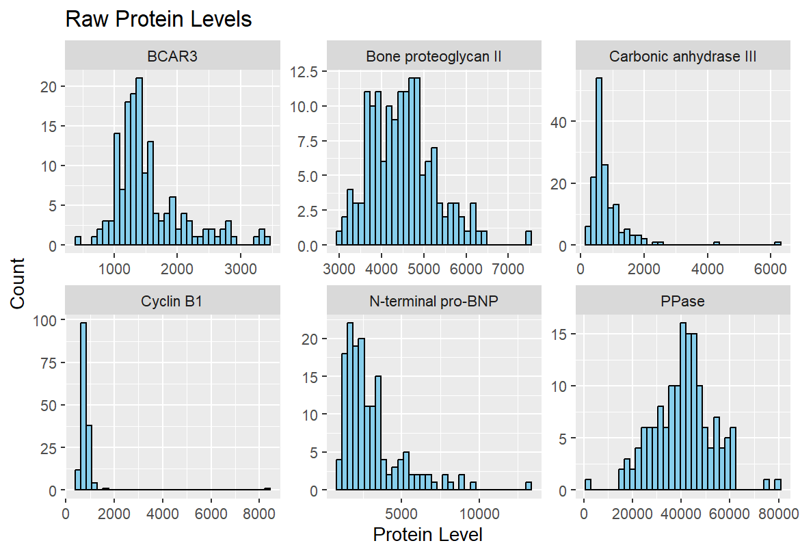
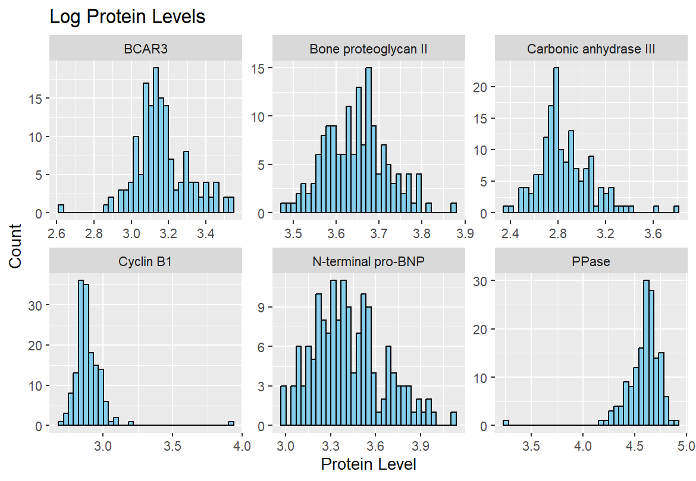
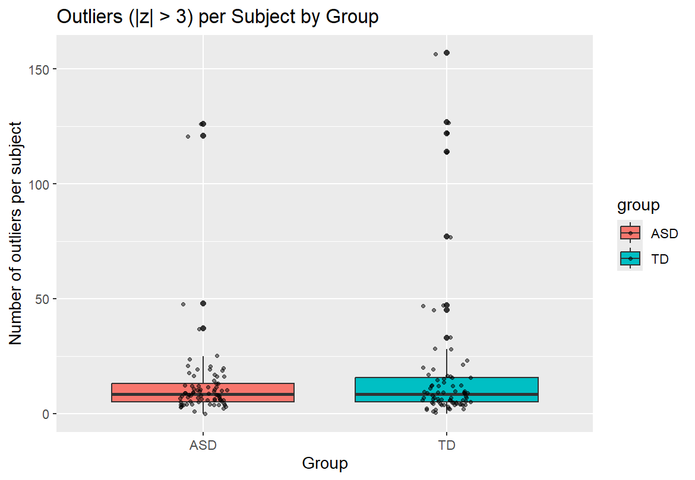
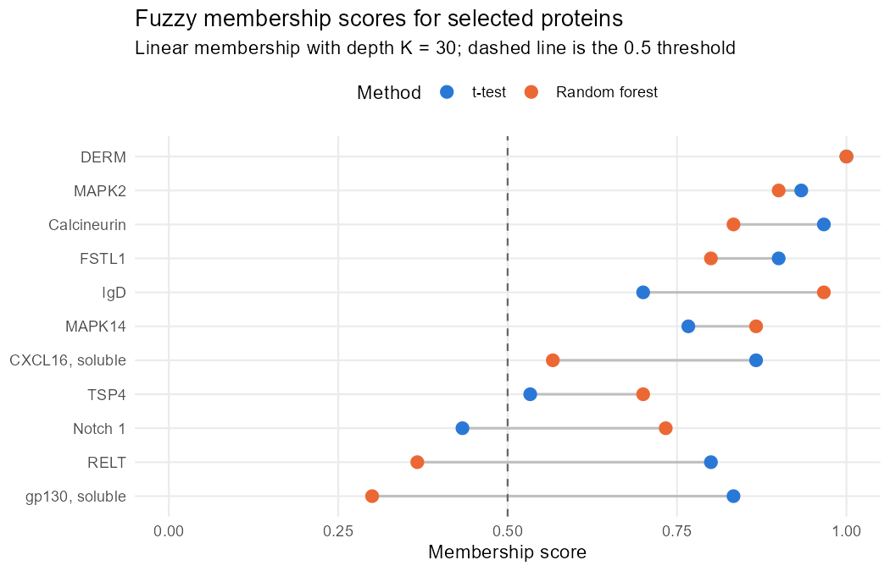
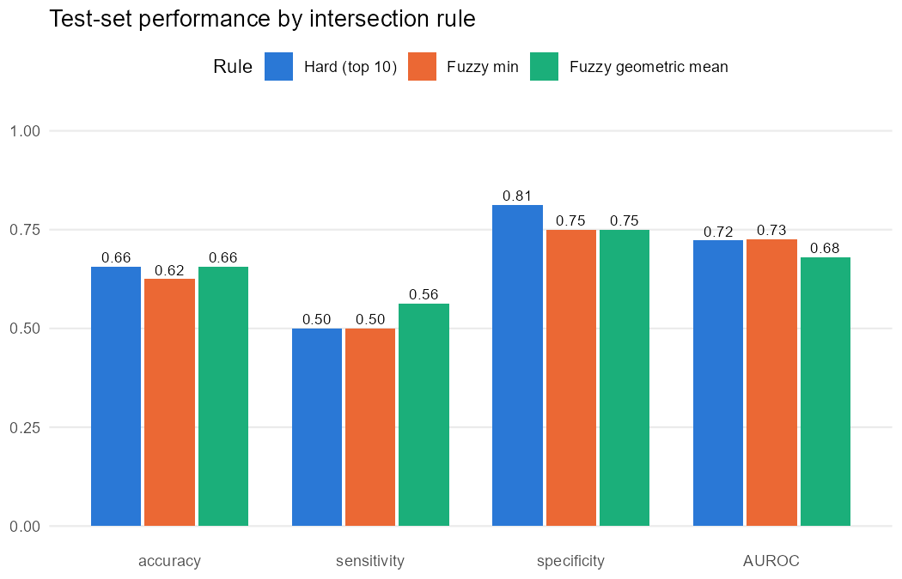
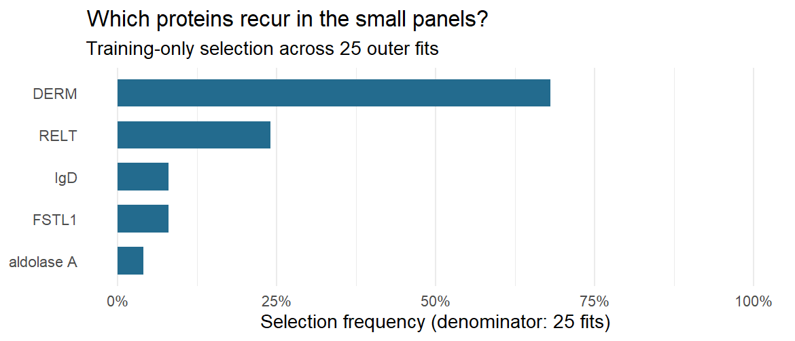
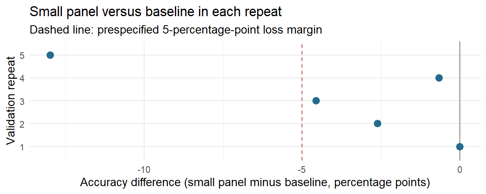

```{r}
# Setup
library(tidyverse)
library(knitr)

knitr::opts_knit$set(
  root.dir = normalizePath("..")
)
```

```{r}
#| label: refresh-q3-results
#| include: false
# This chunk runs from the project root set in the setup chunk above.
dir.create("results/tables", recursive = TRUE, showWarnings = FALSE)
dir.create("results/graphs", recursive = TRUE, showWarnings = FALSE)
q3_jobs <- list(
  list(script = "scripts/q3/Q3-Part-a.R",
       outputs = c("results/tables/q3a_metrics.csv",
                   "results/tables/q3a_selected_proteins.csv")),
  list(script = "scripts/q3/Q3-Part-b.R",
       outputs = c("results/tables/q3b_comparison.csv",
                   "results/tables/q3b_selected_proteins.csv")),
  list(script = "scripts/q3/Q3-Part-C.R",
       outputs = c("results/tables/q3c_comparison.csv",
                   "results/tables/q3c_selected_proteins.csv",
                   "results/graphs/q3c_fig-membership.png",
                   "results/graphs/q3c_fig-metrics.png"))
)
for (job in q3_jobs) {
  inputs <- c(job$script, "scripts/q3/preprocess-split.R",
              "data/biomarker-raw.csv")
  needs_refresh <- !all(file.exists(job$outputs))
  if (!needs_refresh) {
    needs_refresh <- max(file.info(inputs)$mtime) >
      min(file.info(job$outputs)$mtime)
  }
  if (needs_refresh) {
    source(job$script, local = new.env(parent = globalenv()))
  }
}
# Load summaries before the abstract so its numerical claims use current results.
q3a_metrics <- read.csv("results/tables/q3a_metrics.csv")
q3b_comparison <- read.csv("results/tables/q3b_comparison.csv")
q3c_comparison <- read.csv("results/tables/q3c_comparison.csv")
percent <- function(x) sprintf("%.1f%%", 100 * x)
metric_change <- function(new, baseline, percentage = FALSE) {
  difference <- new - baseline
  if (abs(difference) < 1e-10) return("was unchanged")
  amount <- if (percentage) sprintf("%.1f percentage points", 100 * abs(difference)) else
    sprintf("%.3f", abs(difference))
  paste(if (difference > 0) "increased by" else "decreased by", amount)
}
q3b_small <- q3b_comparison[q3b_comparison$top_k == 10, ]
q3b_large <- q3b_comparison[q3b_comparison$top_k == 20, ]
q3c_hard <- q3c_comparison[q3c_comparison$rule == "Hard (top 10)", ]
q3c_min <- q3c_comparison[q3c_comparison$rule == "Fuzzy min", ]
q3c_geo <- q3c_comparison[q3c_comparison$rule == "Fuzzy geometric mean", ]
```

## Abstract

We use serum protein measurements from 154 boys to explore how analysis choices affect the search for potential biomarkers of autism spectrum disorder (ASD). Log transformation reduced right skewness for several sampled proteins, although its effect varied across proteins. Outlying values were concentrated in particular subjects; TD subjects had a higher mean outlier count, while both groups had the same median. With preprocessing and protein selection restricted to training subjects, the Q3(a) classifier achieved `r percent(q3a_metrics$.estimate[q3a_metrics$.metric == "accuracy"])` held-out accuracy. Selecting twenty rather than ten candidates per method changed the panel from `r q3b_small$panel_size` to `r q3b_large$panel_size` proteins; accuracy `r metric_change(q3b_large$accuracy, q3b_small$accuracy, TRUE)`. Relative to a hard intersection, accuracy `r metric_change(q3c_min$accuracy, q3c_hard$accuracy, TRUE)` under fuzzy min and `r metric_change(q3c_geo$accuracy, q3c_hard$accuracy, TRUE)` under the geometric mean. In Q4, LASSO had the highest observed cross-validated accuracy, while a smaller panel reduced the number of proteins at some cost to prediction. These exploratory comparisons do not establish clinical validity.


## Dataset

The publicly available data from Hewitson et al. (2021) contain serum measurements from 154 boys: 76 with ASD and 78 typically developing (TD). The SOMAScan assay measured 1,317 protein variables. The dataset also records group labels and Autism Diagnostic Observation Schedule (ADOS) scores, which are excluded from our classifiers.

Our analysis retains all 1,317 proteins, including the 192 excluded from the published study. The shared preprocessing script takes base-10 logarithms, centers and scales each protein, and clips standardized values to the range -3 to 3. We examine the effects of logging and clipping separately. In Q4 cross-validation, preprocessing parameters and protein selection are determined from training data before evaluating held-out subjects.

## Summary of published analysis

Hewitson et al. (2021) combined protein rankings from random forests, group t-tests, and correlations with ADOS scores. Proteins shared by the top-ten lists formed a core panel, and additional candidates were considered for improving prediction. Logistic regression was used to classify ASD and TD subjects, with repeated training/test splits used to evaluate performance.

As described in the README, our simplified in-class procedure retains 192 variables excluded from the original study and combines t-test and random forest selections. It omits repeated forest fitting, forward selection in logistic regression, and repeated AUROC estimation. The in-class results are therefore not expected to match the original study. We use this implementation as the starting point for the team's four questions.

## Findings

### Impact of preprocessing and outliers

#### Question 1: Log transformation

**Methodology**

To understand the effect of log-transforming the protein levels in biomarker-raw.csv, we took a sample of six proteins from the raw dataset and removed the non-protein columns. We then created two separate versions of the data (the raw numeric values and the base-10 log-transformed values) for comparison. For both versions we calculated the summary statistics (minimum, maximum, mean, median, and standard deviation) as well as Pearson’s second coefficient of skewness $\frac{3(\mu - \tilde{x})}{\sigma}$. Lastly, we generated histograms for the raw and log-transformed values to visually compare the distributions. 


#### Results

For the raw dataset, using Pearson's second coefficient of skewness, where values greater than 0.5 indicate right skew and values less than -0.5 indicate left skew, three of the six proteins we sampled showed strong right skewness (Carbonic anhydrase III = 0.96, N-terminal pro-BNP = 0.94, BCAR3 = 0.84), while Cyclin B1 (0.43) fell just below the threshold, and PPase (-0.15) and Bone proteoglycan II (0.14) were essentially symmetric. The raw standard deviations ranged from 550 to 12,009. After log10 transformation, the three strongly-skewed proteins dropped greatly (N-terminal pro-BNP to 0.38, BCAR3 to 0.46), and the standard deviations compressed from 0.07 to 0.23 across all six proteins.

{#q1_q2_q1-raw-hist-1 width="85%"}

{#q1_q2_q1-log-hist-1 width="85%"}


#### Interpretation

Log transformation compresses large measurements and can reduce right skewness, making relative differences easier to examine. Its effects varied across the six sampled proteins. PPase shifted from approximately symmetric to mildly left-skewed (coefficient -0.15 to -0.55), while Cyclin B1's coefficient increased from 0.43 to 0.59. Carbonic anhydrase III remained right-skewed after logging (0.78). Thus, logging improved symmetry for some proteins but did not make every distribution symmetric. These descriptive results do not establish variance stabilization, and neither scaling nor clipping requires a log transformation.


#### Question 2: Outlier analysis

**Methodology**

To understand if specific subjects are outliers, we first removed trim() from the preprocessing code chunk and kept the log-transformation and scaling. We considered an outlier to be any z-value where $|z| > 3$. We then reshaped the data to a long format and tabulated the number of outliers for each individual subject. Then we calculated the summary statistics (mean, median, standard deviation, and maximum) for the outlier counts by group. Lastly, we then generated a boxplot to compare the distributions visually.


#### Results

Across all 154 subjects, the median number of proteins that were outliers per subject was 8.5. Subject 154 in the TD group had 157 outlying proteins, and 6 subjects across both groups had more than 100. Only 2 subjects (one from each group) had zero outliers.

```{r}
#| label: tbl-q2-group-summary
#| tbl-cap: "Summary of outliers per subject by group."
group_summary <- read.csv("results/tables/q2_group_summary.csv", check.names = FALSE)
knitr::kable(group_summary, digits = 2)
```

#### Interpretation

There were specific subjects that stood out as outliers. While the median subject had 8.5 outlying proteins, subject 154 in the TD group had 157 extreme values, and 6 subjects across both groups had 100 or more. In total, 77 of the 154 subjects had more than 8.5 outliers, and only 2 subjects (one from each group) had zero. If we look at the median of both groups, they both had exactly 8.5 for ASD and TD. However, looking at the mean, the most extreme cases are concentrated in the TD group. The mean number of outliers was 17.6 for TD compared to 13.25 for ASD, and the TD standard deviation was far larger (29.2 vs. 19.8). Overall, the median subject in both groups has the same number of outliers, but group TD has more extreme outliers.

```{r}
#| label: tbl-q2-top-outliers
#| tbl-cap: "Top 10 subjects with the most outliers."
outliers_subject <- read.csv("results/tables/q2_outliers_per_subject.csv", check.names = FALSE)
knitr::kable(head(outliers_subject, 10), digits = 2)
```

{#q1_q2_q2-boxplot-1 width="85%"}


### Methodological variations

#### Question 3(a): Training/Test Split and Protein Selection

**Methodology**

To reduce data leakage during feature selection, the dataset was divided into training and testing sets before starting analysis. Using initial_split() from the rsample package, 80% of the observations were allocated to the training set and 20% to the testing set, with stratification by group. Preprocessing means and standard deviations were estimated on training subjects only; both partitions were then transformed and clipped to [-3, 3] using those parameters. A random seed was set to preserve reproducibility. Protein selection was conducted exclusively on the training data using two approaches. First, statistical tests were used to identify the ten proteins with the strongest evidence of differences between the ASD and typically developing (TD) groups, with p-values adjusted using the Benjamini–Yekutieli procedure. Second, a random forest model was used to rank proteins by MeanDecreaseGini importance, and the ten highest-ranked proteins were selected. The intersection of these two sets was used to identify proteins supported by both selection methods.

A logistic regression model was then fitted using the selected proteins and training data. Model performance was evaluated on the held-out testing set.

#### Results

The selected panel and test-set metrics below are regenerated by `scripts/analysis-main.R` using training-only preprocessing and selection.

```{r}
#| label: q3a-analysis
#| include: false
q3a_metrics <- read.csv("results/tables/q3a_metrics.csv")
q3a_selected <- read.csv("results/tables/q3a_selected_proteins.csv")

```

```{r}
#| label: q3a-results-table
#| echo: false
library(dplyr)
library(knitr)

metrics_table <- bind_rows(
  q3a_metrics
) %>%
  select(.metric, .estimate) %>%
  mutate(
    Metric = recode(
      .metric,
      sensitivity = "Sensitivity",
      specificity = "Specificity",
      accuracy = "Accuracy",
      roc_auc = "ROC AUC"
    ),
    Result = round(.estimate, 4)
  ) %>%
  select(Metric, Result)

kable(
  metrics_table,
  col.names = c("Metric", "Test-Set Result"),
  caption = "Q3(a): Logistic Regression Performance"
)
```

#### Interpretation

The panel contained `r nrow(q3a_selected)` proteins: `r paste(q3a_selected$protein, collapse = ", ")`. These results evaluate one held-out split and do not establish causal biomarkers or generalization to other populations. The historical in-class estimate in Q4 uses full-data selection and a different split, so it is a separate reference.

#### Question 3(b): Larger protein panels

**Methodology**

To examine whether considering more proteins improves prediction, we compared selecting the top ten and top twenty proteins from each method. We used the same 80/20 training/test split as Part (a), and protein selection was performed using only the training data. Proteins were ranked by Benjamini–Yekutieli-adjusted t-test p-values and random forest MeanDecreaseGini importance. Adjusted-p-value ties were broken by raw p-values, followed by protein names. The random forest was fitted once so both panel sizes used the same rankings.

For each comparison, only proteins appearing in both lists were retained. A logistic regression model was then fitted using these proteins and the training data. Both models were evaluated on the same testing set, with predicted probabilities of at least 0.5 classified as ASD.

#### Results

```{r}
q3b_comparison <- read.csv("results/tables/q3b_comparison.csv")
q3b_selected <- read.csv("results/tables/q3b_selected_proteins.csv")
knitr::kable(q3b_comparison, digits = 3)
knitr::kable(q3b_selected)
```

#### Interpretation

Increasing selection from the top ten to the top twenty candidates per method changed the final panel from `r q3b_small$panel_size` to `r q3b_large$panel_size` proteins. Test accuracy `r metric_change(q3b_large$accuracy, q3b_small$accuracy, TRUE)` (from `r percent(q3b_small$accuracy)` to `r percent(q3b_large$accuracy)`), while AUROC `r metric_change(q3b_large$AUROC, q3b_small$AUROC)` (from `r sprintf("%.3f", q3b_small$AUROC)` to `r sprintf("%.3f", q3b_large$AUROC)`). These measures assess different aspects of prediction: accuracy uses a fixed threshold, while AUROC measures ranking across thresholds.

Both panels used the same test subjects and training-derived rankings. The comparison shows the observed tradeoff between panel size and prediction on this split; it does not establish which panel will perform better in a new population. Preprocessing parameters, protein selection, and model fitting all use training subjects only.

#### Question 3(c): Fuzzy intersection

```{r}
# Read saved Q3(c) summaries from scripts/q3/Q3-Part-C.R
q3c_comparison <- read.csv("results/tables/q3c_comparison.csv", check.names = FALSE)
q3c_selected <- read.csv("results/tables/q3c_selected_proteins.csv", check.names = FALSE)
percent <- function(x) sprintf("%.1f%%", 100 * x)
```

**Methodology**

A hard intersection keeps a protein only if it is in the top ten of *both* the t-test and random forest rankings, so a protein ranked 11th by one method is dropped no matter how strongly the other method ranks it. To soften this rule, we used the same 80/20 training/test split as Q3(a) and kept the full ranking of all proteins from each method on the training data. Each rank $r$ was converted to a membership score between 0 and 1,

$$
\mu(r) = \max\left(0,\ 1 - \frac{r - 1}{K}\right), \qquad K = 30,
$$

so the top-ranked protein scores 1 and scores fall linearly to 0 after rank 30. We combined the two scores in two ways:

-   **Fuzzy min**, $\min(\mu_{t}, \mu_{RF})$, the standard fuzzy intersection: a protein is only as strong as its weaker ranking.
-   **Fuzzy geometric mean**, $\sqrt{\mu_{t} \cdot \mu_{RF}}$, which lets a strong ranking from one method partly make up for a weaker ranking from the other.

Proteins with a combined score of at least 0.5 formed the panel. For the min rule, this means both ranks must be 16 or better. For the geometric mean, it is equivalent to requiring a product of scores of at least 0.25. Each panel was used to fit a logistic regression on the training set and was evaluated on the held-out test set, with ASD as the positive class.

**Results**

```{r}
#| label: tbl-q3c-comparison
#| tbl-cap: "Q3(c) test-set performance of each intersection rule (training-only selection, 80/20 split)."
knitr::kable(
  data.frame(
    Rule = q3c_comparison$rule,
    Proteins = q3c_comparison$panel_size,
    Accuracy = percent(q3c_comparison$accuracy),
    Sensitivity = percent(q3c_comparison$sensitivity),
    Specificity = percent(q3c_comparison$specificity),
    AUROC = sprintf("%.3f", q3c_comparison$AUROC)
  ),
  align = c("l", rep("r", 5))
)
```

```{r}
#| label: tbl-q3c-proteins
#| tbl-cap: "Proteins selected under each intersection rule."
q3c_selected %>%
  group_by(rule = factor(rule, levels = unique(rule))) %>%
  summarize(proteins = paste(protein, collapse = ", ")) %>%
  rename(Rule = rule, Proteins = proteins) %>%
  knitr::kable()
```

The hard intersection selected `r q3c_comparison$panel_size[1]` proteins; fuzzy min selected `r q3c_comparison$panel_size[2]`, and the geometric mean selected `r q3c_comparison$panel_size[3]`. The tables and figures show their held-out performance and selected proteins.

{#fig-q3c-membership width="85%"}

{#fig-q3c-metrics width="85%"}

**Interpretation**

Relative to the hard intersection, fuzzy min changed the panel from `r q3c_hard$panel_size` to `r q3c_min$panel_size` proteins. Its accuracy `r metric_change(q3c_min$accuracy, q3c_hard$accuracy, TRUE)` and AUROC `r metric_change(q3c_min$AUROC, q3c_hard$AUROC)`. The geometric mean selected `r q3c_geo$panel_size` proteins; its accuracy `r metric_change(q3c_geo$accuracy, q3c_hard$accuracy, TRUE)` and AUROC `r metric_change(q3c_geo$AUROC, q3c_hard$AUROC)`. The geometric mean allows a strong ranking from one method to compensate partly for a weaker ranking from the other, whereas fuzzy min is limited by the weaker score.

These results describe sensitivity to the combination rule on one split. They do not establish that added proteins are noise or that one rule is generally superior. The test set contains only 32 subjects, so one misclassified subject changes accuracy by about 3.1 percentage points. The depth $K = 30$ and threshold 0.5 were fixed rather than tuned.

The historical 83.9% in-class accuracy uses full-data preprocessing and selection and a different split. Differences from it cannot be attributed solely to leakage or to the intersection rule.

### Improved classifier

#### Question 4: Alternative classifier

```{r}
# Read saved summaries; rendering does not rerun the models.
comparison <- read.csv("results/tables/q4_model_comparison.csv", check.names = FALSE)
selected <- read.csv("results/tables/q4_selected_proteins.csv", check.names = FALSE)
percent <- function(x) sprintf("%.1f%%", 100 * x)
```

We asked whether a different classifier could improve prediction or use fewer proteins. The validated in-class baseline combines adjusted Welch t-tests and random forest selection with logistic regression. We compared it with LASSO, which shrinks coefficients and selects proteins, and logistic regression using a small panel of one to three highly ranked proteins. Inner five-fold cross-validation chooses the LASSO penalty and small-panel size, favoring simpler models when prediction errors are similar.

All three procedures use the same five repeats of stratified five-fold cross-validation, with preprocessing and selection performed within training folds. Accuracy, AUROC, sensitivity, and specificity are averaged over the repeats; protein counts summarize the 25 outer training fits. Paired accuracy differences give each subject equal weight within a repeat, then average the five repeats, matching the table below. The corrected analysis centers its approximate confidence intervals on these same differences; updated numerical intervals are not available in the saved summaries and are not reported here. ASD is the positive class, with predicted probabilities above 0.5 classified as ASD.

```{r}
#| label: tbl-q4-comparison
#| tbl-cap: "Q4 classification performance. Validated metrics average five repeats; protein counts are mean (range) across 25 outer fits. The historical row uses a separate evaluation procedure."
performance <- data.frame(
  Model = comparison$Model,
  Accuracy = percent(comparison$Accuracy),
  AUROC = sprintf("%.3f", comparison$AUROC),
  Sensitivity = percent(comparison$Sensitivity),
  Specificity = percent(comparison$Specificity),
  Proteins = sprintf("%.2f (%d–%d)", comparison$Mean_proteins,
                     comparison$Min_proteins, comparison$Max_proteins)
)
performance$Proteins[1] <- "4"
knitr::kable(performance, align = c("l", rep("r", 5)))
```

The historical in-class model used DERM, RELT, FSTL1, and IgD and achieved `r percent(comparison$Accuracy[1])` accuracy. Because preprocessing and protein selection used all subjects before its 80/20 split, this result is a separate reference and is not directly comparable with the cross-validated estimates.

In @tbl-q4-comparison, LASSO had the highest observed validated accuracy (`r percent(comparison$Accuracy[3])`) and AUROC (`r sprintf("%.3f", comparison$AUROC[3])`), using an average of `r sprintf("%.2f", comparison$Mean_proteins[3])` proteins. Its accuracy was `r sprintf("%.1f", 100 * (comparison$Accuracy[3] - comparison$Accuracy[2]))` percentage points above the validated baseline (`r percent(comparison$Accuracy[2])`). The small-panel procedure achieved `r percent(comparison$Accuracy[4])` accuracy using just `r comparison$Min_proteins[4]` to `r comparison$Max_proteins[4]` proteins per fit (mean `r sprintf("%.2f", comparison$Mean_proteins[4])`). Its `r sprintf("%.1f", 100 * (comparison$Accuracy[2] - comparison$Accuracy[4]))`-point loss was within an exploratory five-percentage-point descriptive margin, although its AUROC and sensitivity were also lower. This margin was not a formal equivalence or non-inferiority test.

```{r}
#| label: tbl-q4-selected
#| tbl-cap: "Final small panel fitted using all subjects. Selection frequency is the fraction of 25 outer training fits containing the protein."
protein_table <- data.frame(
  Protein = selected$Protein,
  Name = selected$Full_name,
  Coefficient = sprintf("%.4f", selected$Coefficient),
  `Selection frequency` = percent(selected$Selection_frequency),
  check.names = FALSE
)
knitr::kable(protein_table)
```

The final small-panel fit selected DERM (dermatopontin; @tbl-q4-selected). The negative coefficient links higher standardized DERM levels with lower modeled odds of ASD. DERM was selected in `r percent(selected$Selection_frequency[1])` of outer training fits, the highest frequency shown in @fig-q4-selection. Selection still varied across partitions, and cross-validation evaluated the selection procedure rather than a fixed DERM-only panel.

{#fig-q4-selection width="85%"}

{#fig-q4-difference width="85%"}

The accuracy differences in @fig-q4-difference vary across repeats. LASSO's observed gain does not establish better population performance, and the small panel's reduced size does not establish equivalent accuracy. These comparisons remain exploratory because they use many candidate proteins and repeatedly evaluate the same 154 subjects. The fixed DERM panel has not been independently validated.

## Conclusion

Log transformation reduced skewness for several sampled proteins but did not improve symmetry uniformly. Outlier counts identified subjects with many extreme measurements; the TD group had a higher mean count despite an identical group median. These findings show why preprocessing choices deserve examination before classification.

With training-only preprocessing and selection, Q3(a) achieved `r percent(q3a_metrics$.estimate[q3a_metrics$.metric == "accuracy"])` held-out accuracy. Increasing candidate-list size in Q3(b) changed accuracy from `r percent(q3b_small$accuracy)` to `r percent(q3b_large$accuracy)`. In Q3(c), hard intersection, fuzzy min, and geometric mean achieved `r percent(q3c_hard$accuracy)`, `r percent(q3c_min$accuracy)`, and `r percent(q3c_geo$accuracy)` accuracy, respectively. These comparisons quantify sensitivity to panel construction on the same split, but the small test set limits conclusions about general performance.

Among the Q4 classifiers, LASSO offered the strongest observed cross-validated prediction, while the small panel offered greater simplicity at some loss of accuracy. The historical in-class result used a different evaluation procedure and is a separate reference. The limited sample and variation in selected proteins mean that independent validation is needed before treating any panel as clinically useful.
